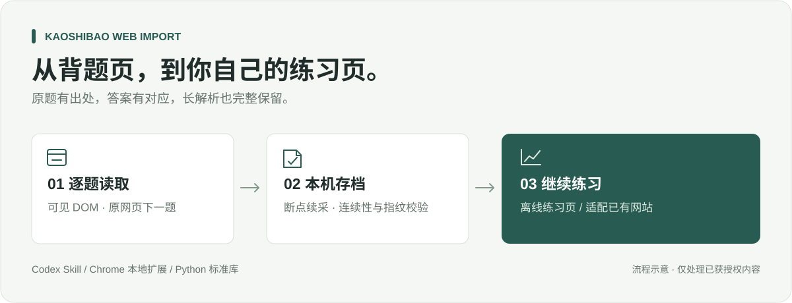

<p align="center">
  
</p>

<h1 align="center">考试宝 · 网页逐题导入</h1>

<p align="center">保留题目、答案与原解析，让已获授权的题库继续陪你练习。</p>

<p align="center">
  <a href="#快速安装">📦 安装 Skill</a> ·
  <a href="#开始使用">🚀 开始使用</a> ·
  <a href="skills/kaoshibao-web-import/references/capture.md">📖 采集指南</a> ·
  <a href="skills/kaoshibao-web-import/references/site-import.md">🔗 网站接入</a>
</p>



一个为 **Codex** 准备的可搬运 Skill。模型负责首次配置和异常判断，本地 Chrome 扩展负责顺序采集，Python 脚本负责校验与生成练习文件。正常采集不需要把整份题库反复传给模型。

> 适用于你拥有访问与导出授权的考试宝背题页面。仓库只提供工具和说明，不附带题库、账号或个人学习记录；这是非官方项目。

## 能做什么

| | 能力 | 实际结果 |
| :-- | :-- | :-- |
| 📄 | 保留原题 | 题干、原选项字母、正确答案、完整原解析分别保存 |
| 💾 | 断点续采 | 逐题保存到扩展本机存储，核对断点后继续 |
| 🔎 | 导入前校验 | 检查题号连续性、总数、答案和内容指纹 |
| 🧩 | 两种目标 | 生成离线练习页，或适配已有练习网站 |
| 🪶 | 减少 token | 正常流程只读统计摘要；采集和转换不调用模型 API |

**图片与公式：**保留已显示的图片地址和 MathML；图片需另行本地化，未保存齐全时会报告缺失，不能标为完整离线。

## 快速安装

把下面这段直接发给另一台电脑上的 Codex：

```text
请从 https://github.com/Titox02/kaoshibao-web-import 安装
skills/kaoshibao-web-import 这个 Skill 到我的 Codex 技能目录。
使用现有 skill-installer；如果已经安装，请先保留旧版再更新。
安装完成后检查 SKILL.md、extension、scripts、references 和 assets 是否齐全。
```

也可以[下载仓库 ZIP](https://github.com/Titox02/kaoshibao-web-import/archive/refs/heads/main.zip)，将其中的 `skills/kaoshibao-web-import` 文件夹放入 Codex 的技能目录。

安装后的入口是 [`SKILL.md`](skills/kaoshibao-web-import/SKILL.md)。Chrome 扩展需要单独加载：进入扩展管理页，开启开发者模式，选择“加载已解压的扩展程序”，定位到技能内的 [`extension/`](skills/kaoshibao-web-import/extension)。由代理执行安装时，仍需遵守当前环境的确认规则。

## 开始使用

### 1 · 告诉 Codex 你的目标

```text
使用 $kaoshibao-web-import。
我已获得当前考试宝题库的访问与导出授权。
请从当前背题页面逐题保存题干、选项、正确答案与完整原解析，
不主动调用题库接口。先试采 3 题核对，再按小批次继续。
导出后生成离线练习页；如需接入现有网站，先准备可审查的导入变更。
正常过程只给我简短进度摘要，出现异常就停止并保留存档。
```

### 2 · 登录、配置、试采

打开已授权题库的“背题模式”，显示答案和原解析，回到第 1 题。让 Codex 根据当前可见 DOM 配置选择器，再用扩展预览和试采 3 题。

**选择器需按实际页面核对。** 页面可能改版，这不是装上即可适配所有题库的一键插件。题干、选项、答案和解析应人工抽查，确认相互对应后再继续。

→ [完整采集指南：字段、批次、恢复与图片](skills/kaoshibao-web-import/references/capture.md)

### 3 · 导出并生成练习页

在扩展中导出存档，再在终端执行。将路径替换为实际位置，输出目录使用新目录：

```bash
python3 "<技能目录>/scripts/finalize_capture.py" "<存档路径>/capture.json" \
  --out "<新的输出目录>"
```

Python **3.9+**，转换脚本仅用标准库，无需 pip 或 npm；Windows 可使用 `py -3` 替代 `python3`。

| 文件 | 用途 |
| :-- | :-- |
| `index.html` | 打开离线练习页；交付时保留整个输出目录 |
| `questions.json` | 标准化题库，供后续适配使用 |
| `capture-check.json` | 连续性、完整性及原解析缺失统计 |

已保存图片时加 `--media-map "<图片映射.json>"`。未采完的存档默认拒绝完整导入；`--allow-partial` 只用于保留明确标记不完整的预览。

→ [把同一份校验数据接入已有网站](skills/kaoshibao-web-import/references/site-import.md)

## 为什么正常流程更省 token

```text
Codex       首次核对页面 → 配置选择器 → 抽查与处理异常
本地扩展    读取当前可见题 → 保存 → 点击下一题 → 小批次暂停
本地脚本    校验存档 → 生成数据和练习页 → 输出一行统计
```

题目原文与长解析不必逐题进入模型上下文。节省程度取决于页面、工具和异常情况；没有承诺固定比例或“零 token”。

<details>
<summary><strong>🔐 权限与适用边界</strong></summary>

- 只使用可见 DOM 和网页真实“下一题”按钮，不读取 cookie、令牌或框架私有状态。
- 扩展没有主动题库接口请求、并发跳题或隐藏缓存读取；原网页响应按钮操作所发出的正常请求仍会发生。
- 使用 `activeTab`、`scripting`、`storage`、`unlimitedStorage` 和 `downloads`，无持久站点 `host_permissions`。内容保存在本机；生成的练习页若仍引用远程图片，打开图片可能联网。
- 出现验证、频率限制、账号异常或题目错位时停止并保留存档。这些措施不能保证不触发原站风控。
- 完成采集与本地校验，不等于已导入线上；网站发布需要具体目标和相应授权。
- 不默认改写原答案、压缩原解析、翻译或合并语言版本。

</details>

<details>
<summary><strong>🛠️ 目录与验证</strong></summary>

```text
skills/kaoshibao-web-import/
├── SKILL.md                 Codex 工作流入口
├── agents/openai.yaml       名称、图标和调用提示
├── extension/               Chrome 本地采集扩展
├── scripts/                 转换、校验及测试
├── references/              按需读取的详细指南
└── assets/                  离线练习页模板与图标
```

在仓库根目录运行已有自动化测试（Node.js 22+ 用于扩展核心测试）：

```bash
python3 -m unittest discover -s skills/kaoshibao-web-import/scripts -p 'test_*.py'
node --test skills/kaoshibao-web-import/scripts/test_capture_core.cjs
```

测试覆盖连续性、指纹、断点记录、跨题库/跨标签拒绝、答案验证及导入输出。模拟测试不能替代当前考试宝页面上的试采与人工抽查。

</details>

---

[查看 Skill 指令](skills/kaoshibao-web-import/SKILL.md) · [提交问题](https://github.com/Titox02/kaoshibao-web-import/issues) · [Chrome activeTab 文档](https://developer.chrome.com/docs/extensions/develop/concepts/activeTab)
